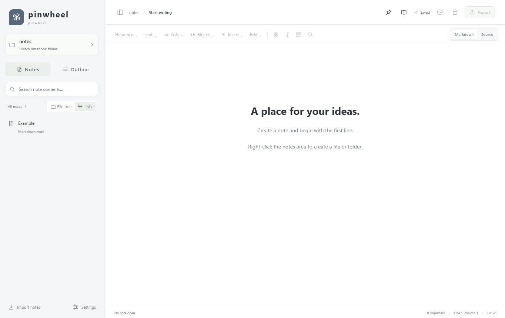

# 风车笔记 · pinwheel

离线 Markdown 笔记应用。自有代码采用 [MIT](LICENSE)；第三方组件保留各自许可证。当前源码为 **0.10.4 开发中**。已发布安装包仍为 [v0.10.3](https://github.com/Lyd-12138/pinwheel/releases/tag/v0.10.3)，不包含此次名称清理。

0.10.4 统一宠物示例、主题默认名称、导出文件名、鸿蒙接口及 macOS 可执行文件名称，保留旧数据读取兼容，详见 [名称检查说明](docs/BRANDING.md)。

0.10.3 修复 Windows“打开方式”中的应用名称和图标，嵌入中英文品牌、版本信息与风车图标，统一安装器和应用内文件关联注册。包含此前的安全修复，详见 [安全复查报告](docs/security-2026-10-26/REPORT.md)。0.10.2 的 Windows 名称和图标打包仍有遗漏，应使用 0.10.3 或后续安装包替换。

pinwheel is an offline Markdown notebook with styled editing and a source mode. The application code is MIT licensed; third-party components retain their own licenses.



## 功能

- 默认 Markdown 模式直接按显示样式编辑；源码模式保留原始 Markdown。代码高亮、表格、任务列表、脚注、LaTeX 与 Mermaid。
- 文件树/列表、笔记/大纲切换、搜索、自动保存、历史与恢复、重命名、副本和文件位置操作。
- 自选图片与附件目录；Markdown、HTML、PDF 和含附件的笔记包导入导出。
- 文档正文密码加密，历史与恢复记录也加密；文件名、图片和附件不加密。
- 多类主题、主题模板、系统字体和桌面宠物定制。窗口置顶、侧栏调宽、会话恢复。
- 简体中文与英语；默认跟随系统，不支持的系统语言使用英语；可手动切换并记忆。没有账号和云同步。

## 平台与下载

安装包应从本仓库的 **Releases** 页面获取。Windows 安装版和便携版须完整保留随附的许可与源码目录。

| 平台 | 本次验证边界 |
| --- | --- |
| Windows x64 | 已发布 0.10.3 安装、启动、卸载和界面回归使用隔离目录验证；实际结果见发布包附带的 manifest 与 validation.json |
| macOS Apple Silicon / Intel | ZIP、架构、符号链接与许可文件结构检查；未实机运行、未 Apple 开发者签名或公证 |
| HarmonyOS NEXT | 0.2.4 开发源码；Web/原生服务适配测试，未 SDK 原生编译、未生成 HAP、未签名或真机测试 |

Mac 完整解压后运行“安装风车笔记.command”，安装到 ~/Applications。脚本执行本机临时签名，不关闭 Gatekeeper。鸿蒙工程见 [harmony/README.md](harmony/README.md)。

升级时会复制旧版 moye-notes/墨页配置与宠物素材，保留原笔记路径；已有 pinwheel 配置不覆盖。旧加密文档和笔记包格式继续兼容。请保留独立备份。

## 开发

需要 Node.js 24.19+、npm，以及支持 Pinwheel 的桌面环境。

```sh
npm ci
npm run build
npm test
npm start
```

Pinwheel 运行时未成功下载时运行 `node download-runtime.mjs`。仅做构建和单元测试时可 `npm ci --ignore-scripts`，此时不能直接启动 Pinwheel。

```sh
npm run build:harmony
npx tsc -p harmony/tsconfig.web.json --noEmit
npm run test:desktop
npm run notices
```

界面测试只使用 test-results 下的隔离配置和模拟笔记。测试脚本必须从项目根目录运行；不要将测试数据提交到仓库。

## 打包

Windows 目录包需要在 Windows 上构建。预先执行 npm run build。

```sh
npm run package
npm run prepare:tools -- --nsis
npm run package:installer
```

macOS 双架构 ZIP 的结构可跨平台生成，仍须在 Mac 实机验证：

```sh
npm run build:main
npm run notices
npm run prepare:tools -- --mac
python scripts/package-macos.py
```

生成用于 GitHub 的干净源码包和发行附件：

```sh
npm run validate:release
node scripts/package-harmony-source.mjs
python scripts/finalize-release.py
npm run audit:release
npm run package:github
```

打包脚本拒绝覆盖已存在的发行物。可用目录和命令的详细说明见 [发布指南](docs/GITHUB-PUBLISH.md)。

## 许可、来源和检查

- [项目 MIT 许可](LICENSE)、[第三方与品牌说明](NOTICE.md)、[第三方声明](THIRD-PARTY-NOTICES.md)。
- ELK 等组件的许可原文、源代码归档和哈希在 [third-party/](third-party/SOURCE-CODE.md)。这些文件不因项目采用 MIT 而改为 MIT。
- [2026-10-26 发布审计](docs/audit-2026-10-26/REPORT.md)记录了实际检查、补正和未确认事项。没有取得 Typora 私有源码；本项目没有获得商标或专利清查结论。
- “pinwheel” 已有其他软件在使用。当前名称由项目作者选定，公开检索不构成商标可用性保证。
- [贡献说明](CONTRIBUTING.md) · [安全报告](SECURITY.md)。

## 当前边界

文档上限 20MB，超大库仍逐文件搜索。没有云同步、多标签、完整外部格式转换或所有 Markdown 扩展语法。文件重命名尚无跨文档引用联动。原生输入法、Mac 与鸿蒙设备兼容性仍需要实机验证。
